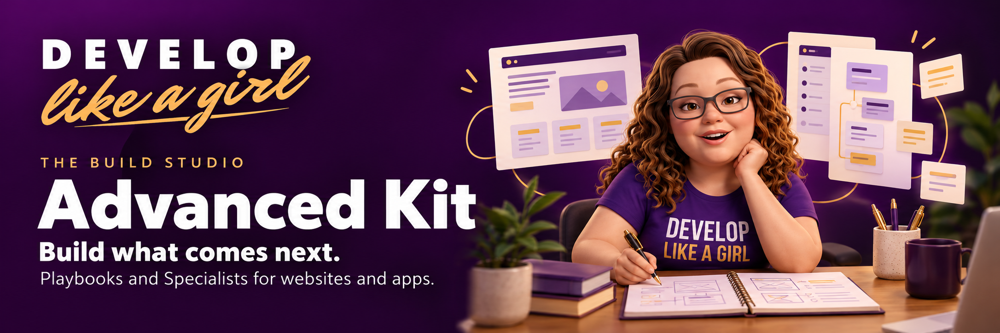
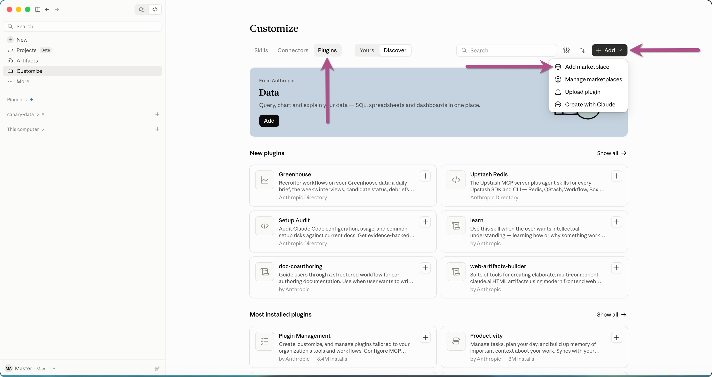
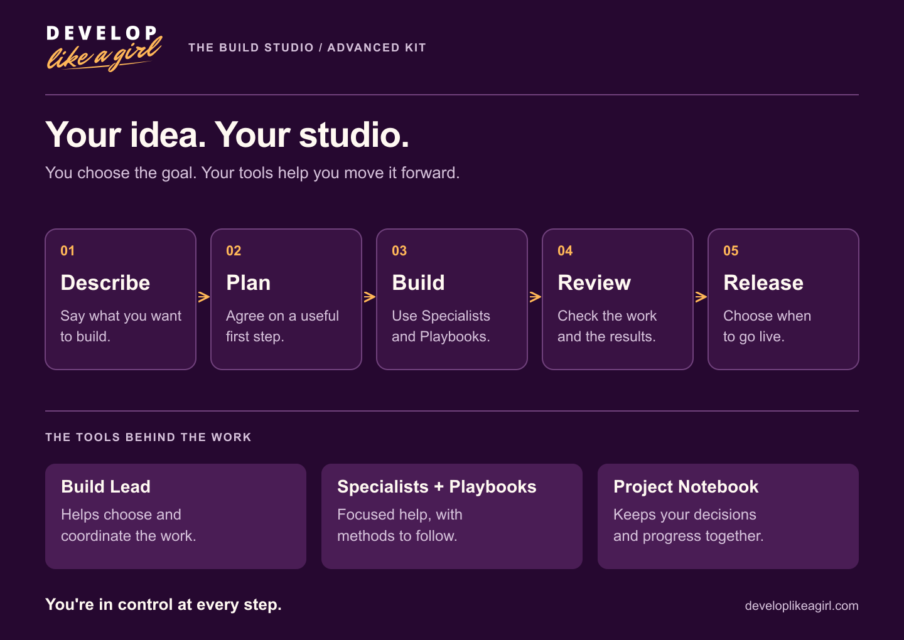

# Develop Like a Girl Advanced Kit

**Build what comes next. Give Claude Code a studio of practical Playbooks and focused Specialists to help you plan, build, understand, and review your project.**

The Advanced Kit brings a repeatable way of working to SvelteKit, Vercel, Neon, WorkOS, and a separate Payload CMS. Describe what you want people to do, choose one useful piece, and work through it with a clear definition of finished. The kit supplies the methods, examples, and supporting resources. You bring the project and make the decisions.

[Start here](learn/start-here.md) · [Install the kit](learn/install-and-verify.md) · [Build a website](learn/build-a-website.md) · [Build an app](learn/build-an-app.md)

## Get your studio ready

Use **Claude Code in the desktop app or terminal**, with your own project folder. Your Claude usage and any hosting or provider services are separate from this repository.

### Install with Claude desktop

Install the [Claude desktop app](https://code.claude.com/docs/en/desktop-quickstart), sign in, and follow this path:

1. Open **Customize → Plugins**.
2. Select **+ Add → Add marketplace → Add from a repository**.
3. Enter `legioncodeinc/develop-like-a-girl-advanced-resources`, select the matching repository, and click **Sync**.
4. Add **dlag-advanced-core** first, then **dlag-advanced-website-builder**, **dlag-advanced-app-builder**, or both.
5. Open **Code**, select a **Local** environment and your project folder, then type `/` to find the kit commands.

**Private repository:** Your GitHub account must have access to Advanced. If Claude asks you to connect GitHub, use the account with access. If the repository does not appear, confirm access before retrying. Advanced does not require Starter.

[](learn/install-and-verify.md)

[Follow the complete six-screenshot installation guide](learn/install-and-verify.md). The screenshots demonstrate Starter; the guide provides the Advanced repository and plugin names. This desktop route does not require a separate CLI installation.

### Prefer the terminal?

With Claude Code CLI and Git installed, run:

```bash
claude plugin marketplace add https://github.com/legioncodeinc/develop-like-a-girl-advanced-resources.git
claude plugin install dlag-advanced-core@dlag-advanced
```

Then install the builder you need, or both:

```bash
claude plugin install dlag-advanced-website-builder@dlag-advanced
claude plugin install dlag-advanced-app-builder@dlag-advanced
```

Core provides the shared foundation for either builder. The [installation guide](learn/install-and-verify.md) explains verification, account sync, and the difference between desktop and terminal installation.

## Have your first conversation

In your Claude Code session, send:

```text
/dlag-advanced-core:get-started Inspect this project and help me choose a small first
task. Explain what already exists, what is missing, and what you recommend. Keep the
proposal in chat for now.
```

You should receive a project summary, a setup proposal, and one recommended next task. This first step inspects and plans. When you are ready to save a plan or implement a local change, say so and name the destination or scope. The [first-session guide](learn/your-first-session.md) walks through a complete example.

You can also ask a plain-language question: “Explain how this page gets its data” or “Help me turn this idea into a first version.” The [prompt collection](learn/prompts.md) gives you useful starting points without making you learn every command.

## Meet your Build Studio

| Part of the kit | What it helps you do |
| --- | --- |
| [Core](plugins/dlag-advanced-core/README.md) | Understand a project, plan work, design interfaces and data, manage context, and review changes. Includes 24 Playbooks and 24 Specialists. |
| [Website Builder](plugins/dlag-advanced-website-builder/README.md) | Build public pages, content, and lead capture. Includes one Playbook and one Specialist. |
| [App Builder](plugins/dlag-advanced-app-builder/README.md) | Build signed-in workflows, data screens, onboarding, search, integrations, and optional payments. Includes six Playbooks and six Specialists. |

A **Playbook** is a method with guides, examples, and templates. A **Specialist** is a focused role that follows that method. The **Build Lead** scopes and routes work; the **Project Notebook** keeps facts and decisions available between sessions. A **Ready Check** assesses the evidence before you decide to release. [See everything included](learn/reference/whats-included.md).



## Work one useful piece at a time

Start with one person and one job they need to finish. Ask for a plan with a visible result, then authorize a bounded implementation. Review the changed files and actual check results before taking the next step. A working page, a verified sign-in flow, or one complete form is a stronger milestone than a long list of proposed features.

The kit can guide local implementation using the tools available in your session. Installation alone does not configure services or deploy your application. Review roles assess supplied evidence; a Ready Check does not publish anything. You decide when to approve installs, provider setup, real messages, payments, commits, and releases.

## Learn your way around

| Your next goal | Open this guide |
| --- | --- |
| Start from an idea | [Your first session](learn/your-first-session.md) |
| Work on something that exists | [Improve an existing project](learn/improve-an-existing-project.md) |
| Keep work focused | [Work with your Build Lead](learn/work-with-your-build-lead.md) |
| Stop repeating the project history | [Your Project Notebook](learn/your-project-notebook.md) |
| Decide whether a change is ready | [Review and release](learn/review-and-release.md) |
| Find a command or understand the stack | [Command reference](learn/reference/commands.md) · [Technology map](learn/reference/technology-stack.md) |

Prefer something to keep beside you? Download the [Getting Started Guide](learn/downloads/getting-started.pdf), [Command Card](learn/downloads/command-card.pdf), or [Project Brief Workbook](learn/downloads/project-workbook.pdf). Editable [worksheets](learn/worksheets/README.md) are included too.

## Get help

Start with [Troubleshooting](learn/troubleshooting.md). When reporting a problem in this repository's [issues](https://github.com/legioncodeinc/develop-like-a-girl-advanced-resources/issues), include the plugin name, exact error, what you expected, and the smallest relevant example. Remove credentials and private customer information.

Browse the full [learning hub](learn/README.md) whenever you need a next step. Package licenses and notices are included with [Core](plugins/dlag-advanced-core/LICENSE.md), [Website Builder](plugins/dlag-advanced-website-builder/LICENSE.md), and [App Builder](plugins/dlag-advanced-app-builder/LICENSE.md).
