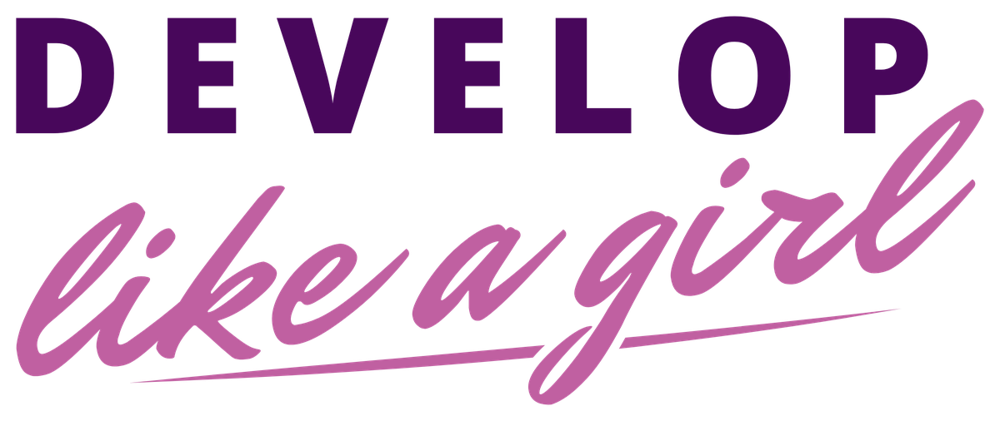
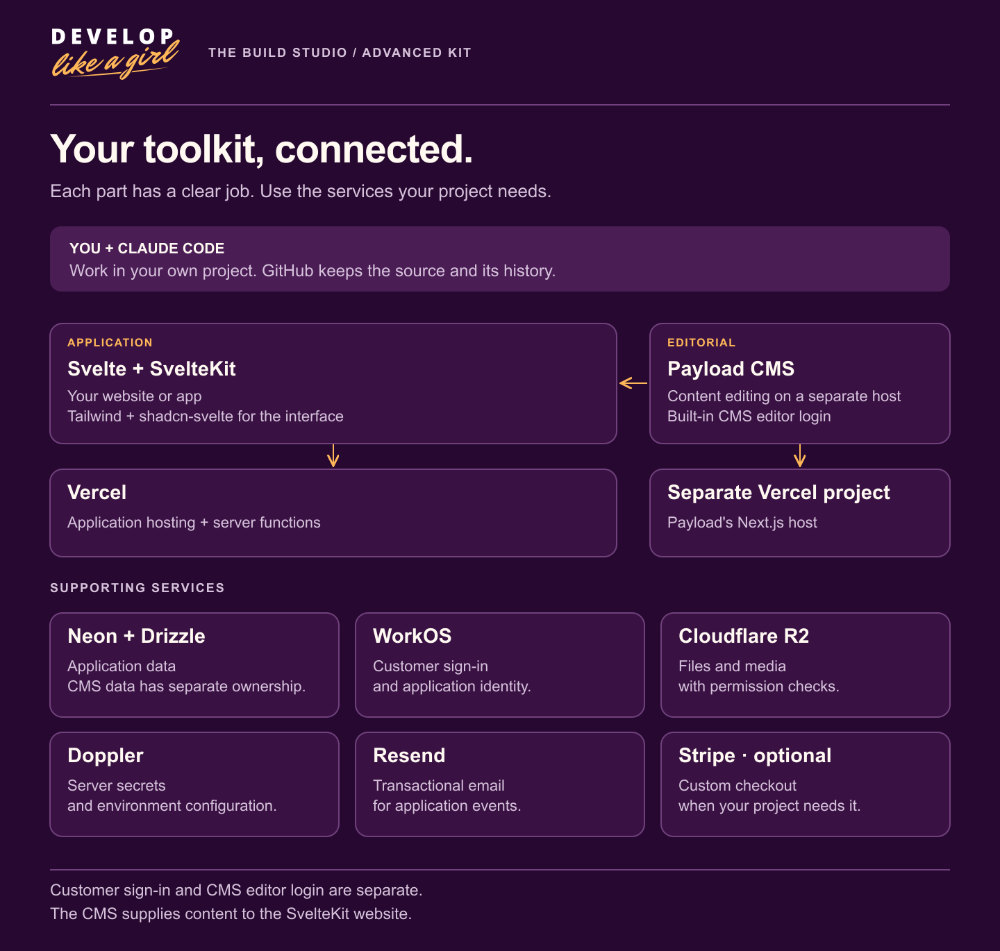

<picture>
  <source media="(prefers-color-scheme: dark)" srcset="../../assets/brand/dlag-signature-on-dark-1200.png">
  
</picture>

**THE BUILD STUDIO · ADVANCED KIT**

# Technology stack

The Advanced Kit assigns each part of the system a clear responsibility. These are the supported implementation patterns; installing the plugin does not create service accounts or configure a running application.

| Area | Technology | Responsibility |
| --- | --- | --- |
| Interface | Svelte 5, SvelteKit 2, Tailwind, shadcn-svelte | Public and signed-in web experiences. |
| App hosting and server | Vercel | SvelteKit Node server functions and application deployment. |
| Application data | Neon PostgreSQL and Drizzle | Application records, queries, and schema management. |
| App identity | WorkOS | Customer identity, sessions, and organization membership. |
| Editorial content | Payload 3 on a separate Next.js/Vercel host | Editor-managed content, drafts, and publication; Payload manages editor login. |
| Private files | Cloudflare R2 | Authorized object uploads and downloads. |
| Secrets | Doppler | Private environment configuration and credential delivery. |
| Transactional email | Resend | Product-triggered messages and delivery handling. |
| Optional payments | Stripe Elements | Custom checkout and payment lifecycle integration. |

## Boundaries that matter

Private credentials stay on the server. Identity establishes who is making a request; authorization decides which records and actions that person may access. File access and search must respect the same permissions as the underlying application. Payment and message workflows need explicit verification of their provider behavior.

Payload is a separate editor application with its own login boundary. WorkOS belongs to the customer-facing app. A successful CMS login is not evidence of customer permissions. Use server-side ownership and organization checks for Neon data.

## Add services when the feature needs them

A public information page does not require every provider in the map. Start from the accepted feature and identify its actual dependencies. The current email resources cover transactional messages. Newsletter campaigns and a general-purpose background-job system are not bundled features.

For an existing project, compare its stack before implementation and resolve meaningful differences with the owner. These guides do not authorize a stack migration.

**Related:** [Everything included](whats-included.md) · [Build a website](../build-a-website.md) · [Build an app](../build-an-app.md).

---

[Learning hub](../README.md) · [Kit overview](../../README.md)
